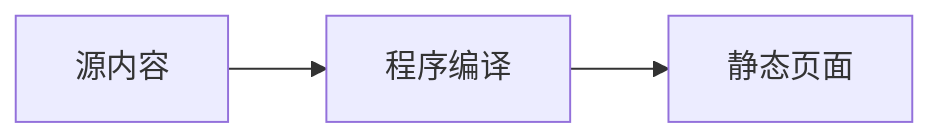

# 内容渲染：Markdown、LaTeX 公式、代码块与 Mermaid

核查日期：2026-10-07（Asia/Shanghai）。本文件补充已确认的中文个人博客需求，只做方案与验收设计，未安装渲染工具或修改产品代码。

## 1. 统一源内容与编译边界

AI 上传、修改的是受约束的 Markdown、元数据、图片及明确的公式/图源码，**不能直接写文章 HTML 页面、模板、CSS、JavaScript 或发布目录**。正文、About 和分类/标签说明都通过同一个程序编译入口生成静态界面；后台预览、确认发布、回滚和导入恢复复用同一入口。

Go 服务保留内容权威、Markdown AST、目录、代码高亮、任务状态与发布控制；KaTeX 和 Mermaid 是受控发布时渲染依赖。Goldmark 本身不是 LaTeX 排版器或 Mermaid 渲染器，不能因为添加一个代码 fence 就宣称支持公式和图。

推荐生成完整静态阅读产物：Goldmark + Go Chroma，KaTeX `renderToString` 输出公式 HTML/MathML，Mermaid CLI 输出 SVG 图资产。读者无须执行 KaTeX/Mermaid JS；有公式的页面仍需 KaTeX CSS/字体，有图的页面仍需下载图资产。

代价必须明确：**静态阅读 0 JS 不等于发布环境只有 Go**。KaTeX 服务端渲染需要可执行 JS 的构建环境；官方 Mermaid CLI 需要 Node + Puppeteer + Chrome/Chromium。若单容器必须在收到 AI 修改后自动编译，镜像内要保留这些发布工具，不能多阶段构建后把它们删掉。没有额外常驻 Node API 服务，但镜像体积、构建峰值与冷启动都会增加。

## 2. 支持的源语法

| 类型 | 首版约定 | 编译产物 / 边界 |
| --- | --- | --- |
| 普通 Markdown | H1–H6、段落、粗斜体、链接、图片、有序/无序列表、引用、分隔线、表格、task list、脚注、行内代码 | 语义化 HTML；GFM/Footnote 使用固定 Goldmark扩展；目录只基于正文 heading；链接/媒体受 URL 与资源校验 |
| 行内公式 | `$...$`；原样美元符号写 `\$` | KaTeX 非 display 公式；parser 在 AST 层识别，不扫描代码块/行内代码 |
| 块公式 | 单独一行 `$$`，中间 TeX，再以单独一行 `$$` 结束；可提供明确的 `math` fence 作为同义块语法 | KaTeX display 公式；长公式横向滚动而不是撑破页面 |
| 常规代码块 | fenced code 与语言名，例如 `go`、`html`、`markdown`、`latex`、`tex`、`json` | Chroma 高亮；**全部是源码文本，HTML/Markdown 不执行、不递归渲染，latex/tex 不编译为文档**；未知语言按纯文本安全展示 |
| Mermaid | 仅语言名为 `mermaid` 的 fence，内容是 Mermaid DSL | 发布时识别图类型并编译为 SVG；不是普通源码高亮，也不把它转成 Go/HTML 示例 |
| HTML 原文 | 不支持作为正文中可执行的 raw HTML；HTML 示例放 `html` fence | 按 AST 拒绝普通正文中的 raw HTML block/inline 节点；不能开启 Goldmark unsafe 绕过统一源约束 |

公式只支持 KaTeX 所支持的行内/块级数学语法，不支持完整 `.tex` 文档、`\documentclass`、任意宏包、外部文件包含、PDF 排版或 TeX 系统执行。`latex` fence 用于展示 LaTeX 源码，`math` fence 才表示块公式。KaTeX 支持列表用于校验具体命令，不把“支持 LaTeX 公式”扩大成安装完整 TeX 环境。[KaTeX 支持函数](https://katex.org/docs/supported.html)。

美元号边界需有固定规则与测试，包括 `\$`、货币金额、代码中的 `$`、跨行/未闭合分隔符。公式标记处理不能采用对整篇 Markdown 的无上下文正则替换；代码 fence、行内 code 和普通正文的含义必须先区分。

`\(...\)` / `\[...\]` 可作为同义语法兼容，但只有 AST parser 确保反斜杠不会先被普通 Markdown 转义消费、代码内不解析且有测试覆盖时再开启；首版规范首先保证 `$...$` / `$$...$$` 与 `math` fence。

AI 上传图片首版支持 PNG/JPEG/WebP/AVIF/GIF，验证真实类型、尺寸、像素数和大小；可保存展示不代表承诺全部格式的转码。外部 SVG 与本机程序编译的 Mermaid diagram asset 是不同来源，上传 HTML/SVG 不自动受信。源文支持本站资产 ID 和 HTTPS 外链图片；外链由浏览器直连，后端不默认抓取或代理，备份只保存引用。

外部视频采用结构化 URL，经明确适配的平台转换为程序生成的播放器；不接收任意 iframe / HTML，不上传、存储、转码视频文件。不支持的平台和无法加载的播放器保留可点击链接。私有预览默认显示占位链接，不自动向第三方发送预览内容或鉴权信息；公开播放器的网络 / 脚本依赖与统计脚本一样单列，不纳入正文、公式、图表的零 JS 保证。程序生成的受限播放器节点使用独立策略，不通过放开 Markdown raw HTML 实现。具体平台适配需核对官方支持方式。

语法示例（源 Markdown，不是可写入发布目录的页面）：

````markdown
行内公式：$E=mc^2$。字面美元：\$20。

$$
\int_0^1 x^2\,dx = \frac{1}{3}
$$

```html
<script>alert('这是要展示的源码，不能执行')</script>
```

```markdown
# 这是代码块中的 Markdown，不生成文章标题或目录
```


````

建议默认 Mermaid 类型允许名单覆盖 flowchart/graph、sequenceDiagram、classDiagram、stateDiagram/stateDiagram-v2、erDiagram、gantt、pie、timeline。**所有允许类型都必须编译、验证并产生图资产**；其他类型明确诊断为当前未支持，不能悄悄显示为代码冒充图。允许名单是受版本固定的技术配置，增加任何类型时加入语法、中文标签、输出结构与安全样本验收。

Mermaid 支持范围以锁定版本为准，不能用 Mermaid Tiny 减包后仍承诺完整版能力；官方说明 Tiny 不支持 mindmap、architecture、KaTeX 及 lazy loading。首版图类型名单、嵌套图内公式和更复杂图类型的扩展要在该配置中显式表达。[Mermaid 使用与 Tiny 限制](https://mermaid.js.org/config/usage.html)。

## 3. 渲染路线比较

| 路线 | 阅读侧 | 发布/构建侧 | 结论 |
| --- | --- | --- | --- |
| 推荐：发布时 KaTeX + Mermaid CLI | 完整公式、图与代码；0 可执行阅读 JS | Node，Mermaid/Puppeteer/Chromium、本地字体；有界子进程 | 功能可查证、SEO/GEO 可见、预览与发布一致；接受额外构建依赖但必须测成本 |
| 仅含内容页 lazy 加载浏览器 KaTeX/Mermaid | 普通页面仍可 0 JS，含公式/图页需要 JS、字体、layout 执行 | 可减少服务器浏览器依赖，但仍需锁定和打包 JS | 会让无 JS、爬虫与首屏看到未编译源码，不作为默认；不能称同样的完整静态渲染 |
| Go 内嵌 JS VM 跑 KaTeX | 潜在可预渲染无 JS 公式 | 需要验证 ECMAScript/模块兼容、CPU 中断、内存限额与库升级 | 没有本项目验证或官方 Go 接口，不当成已落地的轻量替代 |
| Go 自研 TeX→MathML 或 Mermaid DOM 替代实现 | 潜在小依赖 | 需自行实现大量语法/排版；Mermaid 通常需要 DOM、字体测量与布局 | 只是研究方向，不作为首版承诺；不能以 MathML 浏览器支持等同于完整 TeX 编译 |

公开界面不引入 React/Vue。后台仍是 Go 模板与少量必要 JS，预览使用与上线相同的正文 HTML/SVG 编译结果；确认后仅服务端时间及其派生字段定稿，不重新编译正文或更换算法。外部视频播放器按上述独立适配规则展示。

## 4. KaTeX：服务端公式与资源

官方 API `katex.renderToString` 可在服务器生成字符串；建议 `output: "htmlAndMathml"`，HTML 负责视觉、MathML 改善辅助技术可读性。它不需要浏览器 DOM 才能把公式转换成字符串。[KaTeX API](https://katex.org/docs/api.html)、[输出选项](https://katex.org/docs/options.html)。

| 配置 | 建议默认 | 理由 / 限制 |
| --- | --- | --- |
| `trust` | `false` | 禁止可加载外部资源或修改 HTML 属性的受信命令；源内容不能覆盖配置 |
| `throwOnError` | `true` | 无效/不支持公式阻止预览 ready 与发布；不把红色报错文本当成功产物 |
| `maxExpand` | 显式有限值，例如默认 1000，另有限时执行 | 控制宏展开；禁止 Infinity；它不是整个进程 CPU/内存隔离 |
| `maxSize` | 显式有限 em 值，原型按排版验证 | 官方默认 Infinity 会允许极大尺寸；有限值仍需产物大小/横向布局检查 |
| `strict` | 固定非标准LaTeX/Unicode特性的告警处理策略 | 它控制语法忠实性与Unicode度量告警，不能代替 `trust`、受限命令和产物检查；中文 `\text{}` 字体与告警需单独验证 |
| 宏 | 编译器控制的有限宏；每公式或每篇独立宏对象 | 不跨文章共享可变 macros，避免 `\gdef` 污染后续文章；不允许用户 JS 函数宏 |

`trust=false` 不应被静默渲染成红色未知命令后就算成功：编译器还需把禁止命令/告警转换为明确诊断。KaTeX 官方提醒错误字符串可能含未转义源 TeX，后台日志与 HTML 诊断必须作为普通文本输出。[KaTeX 安全说明](https://katex.org/docs/security.html)。

即使发布时已经渲染 HTML，视觉公式仍需要同版本 CSS 与 fonts，不能只部署输出 span。资源从本站固定路径提供，避免每篇文章依赖第三方 CDN。CSS 引用字体相对 URL，打包时保持或正确重写路径；只在有公式的页面引用公式样式，按实际需要加载字体，不在每页预载全部字体。[KaTeX 浏览器资源布局](https://katex.org/docs/browser.html)。

KaTeX 生成物需要独立、受版本固定的 HTML/MathML/SVG 与属性策略。普通 Markdown 的 UGC sanitizer 默认策略会删掉公式需要的 MathML、class 或数值布局 style；不能为了排版直接放开全部 style/SVG，也不能用一次普通净化后公式破损当兼容。应对受控公式 renderer 的输出作专用检查/兼容净化，再与普通 Markdown 片段合成；模板的其他字段仍自动转义。官方也说明支持全部 KaTeX 需要较宽的 MathML/SVG allowlist。[KaTeX 安全说明](https://katex.org/docs/security.html)。

## 5. Mermaid：CLI、浏览器与 SVG 边界

官方 CLI `mmdc` 接受 Mermaid 定义并输出 SVG/PNG/PDF；首版选择静态 SVG。其 package 包含 Node 入口与 Puppeteer peer dependency，官方 Dockerfile 安装 Chromium 并配置浏览器路径。因此**选择官方 CLI 不是纯 Go 渲染**。不在发布时执行联网 `npx @latest`；固定依赖、浏览器与字体，构建镜像时安装，运行时离线调用。[Mermaid CLI](https://github.com/mermaid-js/mermaid-cli)、[CLI package.json](https://github.com/mermaid-js/mermaid-cli/blob/master/package.json)、[官方 Dockerfile](https://github.com/mermaid-js/mermaid-cli/blob/master/Dockerfile)。

`securityLevel: "strict"` 编码文本中的 HTML 标签并禁用点击；`sandbox` 是 Mermaid 在 iframe 中渲染的模式，可能妨碍交互，**不是 Node/Chromium 发布任务的 OS 沙箱，也不能假定 CLI 导出的独立 SVG 继承 iframe 隔离**。不采用 loose/antiscript，也不允许文章内配置 directive/frontmatter 改写 securityLevel、字体路径或其他构建参数。[Mermaid 安全级别](https://mermaid.js.org/config/usage.html)。

建议固定 `strict`、禁用 HTML labels（按所选版本/图类型正确设置 `htmlLabels:false`）、禁用点击回调和外部 URL/图片/图标加载，默认用 SVG 原生 text 标签与受控中文字体。不同图类型是否仍输出 `foreignObject` 要逐项测试；如果存在未允许结构，阻止构建，不临时放开整个 HTML。源码校验、无网络构建与产物检查共同生效，不能只靠字符串删除 `<script>`。

默认以本站 `` 引用独立图文件，alt 为图名，并附可读说明；可用 HTML `details/summary` 展开转义后的原始 Mermaid 源码，无 JS 也可查看。不把未经检查的 SVG 内联到正文，不用 object/embed/iframe 承载文章图。图资产命名按 source + renderer version + config + font hash 派生，单独校验尺寸、viewBox、字体、标签是否裁切；复制按钮属于 P1 可选。

产物检查应拒绝 script、事件属性、foreignObject、非本地片段 href、CSS 外部 URL/@import 等主动结构；SVG/MathML namespace 与 URL 语义需要正确解析。编译器生成的受控图 CSS 与 marker/local-fragment 引用另做明确允许策略。生成失败或命中禁止结构都返回原 fence 的行列诊断。

“严格设置 + 净化”不能证明所有SVG都不可能执行脚本。图直接打开与通过img嵌入的浏览器上下文不同：Mozilla说明img上下文会限制JS/外部资源，限制不适用于直接浏览或document嵌入。**私有SVG仍走 `/admin/previews/` 的会话鉴权及私有资产路径**，不能为了不带Cookie把草稿图公开。编译产物禁止主动结构，预览只以img嵌入并配置资产响应CSP、正确MIME/nosniff；不能把未验证SVG作为同源document返回或嵌入。须真实浏览器验证，必要时退为受控PNG也不能掩盖未验证产物。[Mozilla SVG-as-image](https://developer.mozilla.org/en-US/docs/Web/SVG/Guides/SVG_as_an_image)。

首版图是静态图，点击、tooltip、链接跳转和任意外部 icon pack 不属于功能承诺。若恢复这些交互，必须重新评估安全、JS 与可访问性，不可仅改成 `loose`。

## 6. Go 代码高亮与 AST 编译顺序

Chroma Go 库输出高亮 HTML，建议 `WithClasses(true)` 配固定小型 CSS，不把每个 token 的任意 inline style 混进正文。HTML/Markdown fence 源文本中的 `<script>`、标签、反引号和 TeX 标记均保留为代码，不进入其他 renderer。`mermaid` 与 `math` fence 先按 AST 分派，不能再被通用高亮器吞掉。[Chroma 官方库](https://github.com/alecthomas/chroma)、[HTML formatter 源码](https://github.com/alecthomas/chroma/blob/master/formatters/html/html.go)、[Goldmark 高亮扩展](https://github.com/yuin/goldmark-highlighting)。

沿用栈文已锁定候选的 Goldmark/Chroma 大版本，不因检索结果出现新 v3/v2 组合就无意升级整个 parser。可选 Goldmark 高亮扩展要与锁定的 Goldmark/Chroma 版本相容，原型验证后固定。

建议编译顺序：

1. 验证内容类型、大小、元数据、资源键与授权；解析 Markdown 并保留原始 source offset。
2. 分派普通 Markdown、代码、公式与 Mermaid AST 节点；统一生成稳定 heading ID、目录和非可执行代码文本。
3. 渲染公式与允许图类型；应用固定配置、隔离工作目录、超时/内存限制；命中缓存时仍验证产物清单与版本。
4. 对普通 Markdown、公式结构与 SVG 分别做适合的策略检查，合成固定 Go 页面模板；AI 不提供模板函数、任意标签或 CSS。
5. 抽取搜索纯文本：保留代码文本、图题/说明和可读 TeX 源；不要把 KaTeX 视觉 span 与隐藏 MathML重复索引，也不要把 SVG markup 当正文。
6. 校验输出、链接、资源、目录和 renderer manifest；预览成功后将确认绑定到源 revision、settings/taxonomy snapshot 与渲染配置，再激活 release。

上传解析失败保留为待修复上传，不替换现有草稿；解析成功后以 CAS 提交新草稿，再执行上述完整渲染预览。确认同时绑定 ChangeSet 和时间定稿规则；正文 / 图 / 公式产物在确认后复用，程序仅填入公开时间、相关列表排序和 SEO / 搜索字段，记录最终产物 hash。外链内容不受本站 hash 保证，确认固定的是 URL 和嵌入配置。

## 7. 诊断、缓存与可重复预览

任一公式/图语法错误、不支持命令、禁止资源、超时或产物检查失败，必须使构建失败，后台显示文章/单页 ID、节点类型、源行列、诊断代码与转义后的上下文；不生成 ready release，也不继续推送。保留当前成功站点。Mermaid/KaTeX 返回的位置映射不到精确列时，至少显示 fence/公式起始行和节点内偏移，不能承诺库永远给出完整行列。

预览 manifest 包含 source hash、parser/Chroma/KaTeX/Mermaid CLI/Puppeteer/Chromium 版本、完整有效 renderer 配置、模板/CSS/font 文件 hash 与允许图类型。修改 renderer、字体或配置后使旧预览确认失效，重新构建/预览；不能后台预览成功后发布时自动更新库版本。

图和公式片段缓存按源 + 配置 + renderer/font hash 命名。相同源码不重复启动浏览器；无 Mermaid 内容的发布不启动 Chrome。每个发布任务最多一个有界渲染 worker，分批复用浏览器或进程时保持篇际状态隔离。子进程不继承 master token 或第三方凭据，不执行拼接 shell，不允许源码选择任意本地文件路径，网络访问默认禁用。

Chromium sandbox 在目标 Linux/容器上的可用性尚未验证；不能以默认 `--no-sandbox` 作为安全方案。需对发布用户、可写目录、进程资源和容器隔离做原型验证；进程超时后能终止整个子进程树并回收临时文件。不能承诺用 Go context 就自动获得 Chrome 的资源隔离。

## 8. 可测试的轻量范围与未验证事项

| 范围 | 首版设计预算 / 验收 |
| --- | --- |
| 普通阅读页 | 可执行 JS 0；公共基础 CSS gzip 20 KiB预算保持；没有公式/图/高亮代码就不下载对应资源 |
| 代码页 | Chroma高亮CSS单列资源预算，不把它与KaTeX或公共基础CSS混成整页20KiB承诺；纯文本代码始终可读 |
| 公式页 | 公式已经在源 HTML 中，禁用 JS 可见；KaTeX CSS/字体单列资源预算并测实际加载，不能挤入“全站只有系统字体”的旧承诺 |
| 图页面 | SVG 已存在、无客户端 Mermaid运行时；图文件体积与文字可读性逐项检查；手机可缩放/横向滚动而不溢出 |
| 内容容量 | 先用约 1,000 篇中文文章，含代表性长代码、公式与图；记录全量/修改单篇构建时长、镜像大小、峰值内存和进程数 |
| 渲染任务 | 原型先约束单个 fence/公式长度、每篇图/公式数、单图节点/边数、SVG输出尺寸和任务超时；数值以真实样本确定，不是已测性能 |
| 安全样本 | raw HTML、HTML/Markdown fence 的 script、KaTeX trust 命令/宏循环/超大尺寸、Mermaid directive/外链/主动SVG结构均不能绕过编译 |
| 布局样本 | 中文及技术符号、中文图标签、分式/矩阵/长公式、重复标题目录、每个允许图类型、字体缺失、固定样式与小屏；暗色若后续明确再追加 |
| 发布失败 | 注入公式/图解析错误或终止 Chrome，旧 release 继续服务；错误定位到源；不推送失败版 |

额外 Node/Chromium 构建栈的实际镜像体积、构建峰值、中文字体与所有允许图类型的兼容性、KaTeX 净化后的视觉/辅助技术表现都尚未测量。这些是实现风险与原型验收内容，不是要求用户重新批准已提出的公式/图支持。若测量发现单容器构建超出资源目标，再比较离线/CI构建或明确改变部分页面的 JS预算；不暗示纯Go替代已验证。

本页的零 JS 预算指正文阅读与公式 / 图表展示功能；第三方访问统计和外部视频播放器的脚本 / 网络依赖单独记录，不计作 KaTeX 或 Mermaid 浏览器运行依赖。公式与 Mermaid 构建进程仍离线，外链媒体支持不会放开它们的外部资源权限。

## 9. 研究记录

- 本轮新增 4 次 Exa 搜索，每次 `numResults=5`，共 20 个检索结果槽位，包含重复/排除项，不是 20 个独立已核验来源。
- 主要一手依据为 KaTeX API/options/security/browser 文档、Mermaid 使用文档与官方 CLI README/package/Dockerfile、Chroma 源码与 Goldmark 高亮扩展；Mozilla 官方 SVG image-context 文档补充浏览器边界。
- 不重查前轮 Go/SQLite版本，不复制完整上游仓库，不安装 Node/Chromium/TeX或执行产品实现；所有预算为建议，未宣称已经完成运行验证。
