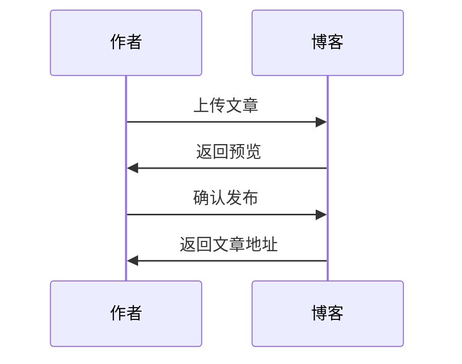
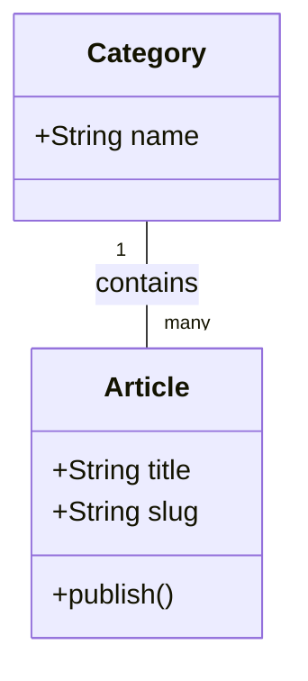
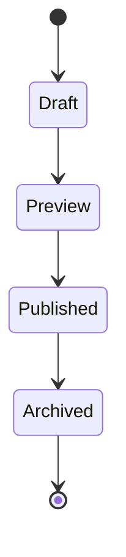
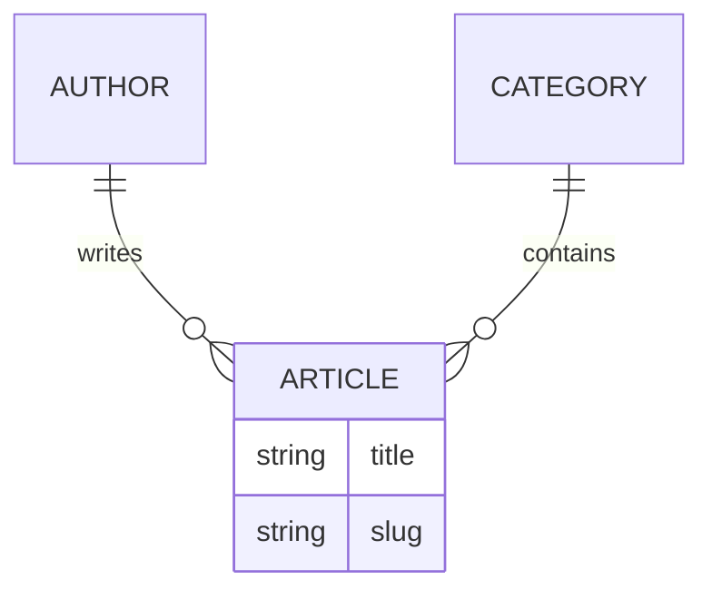
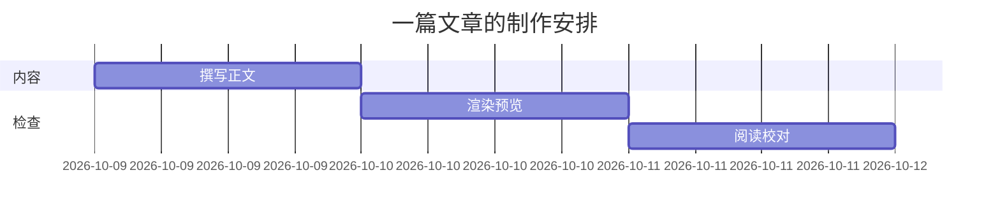
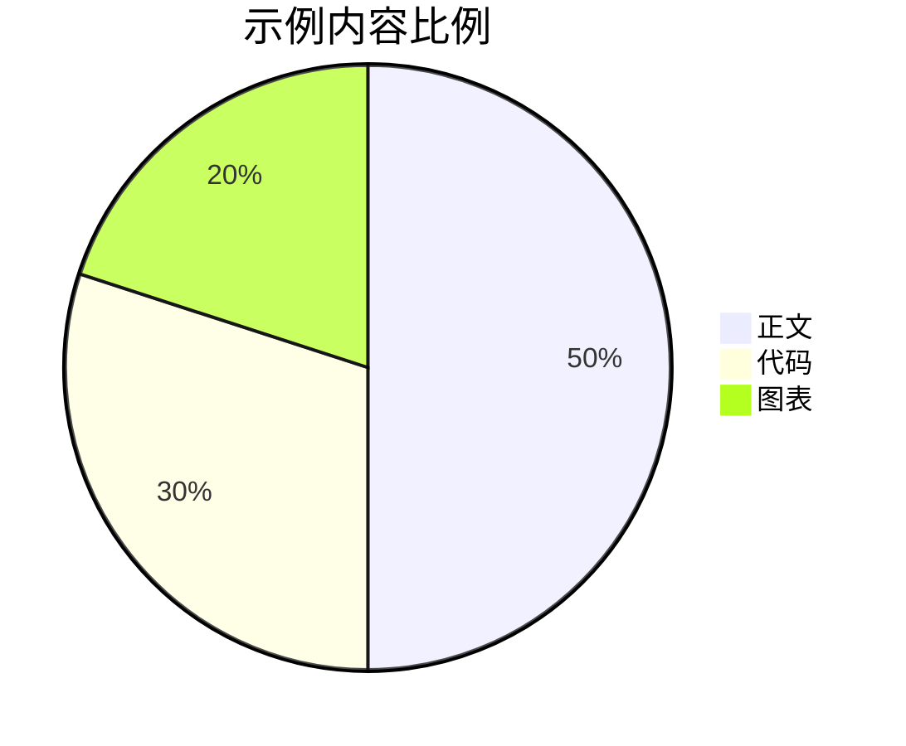
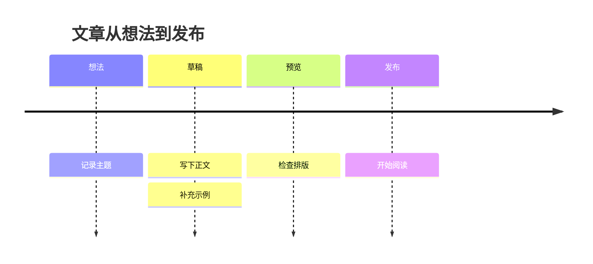
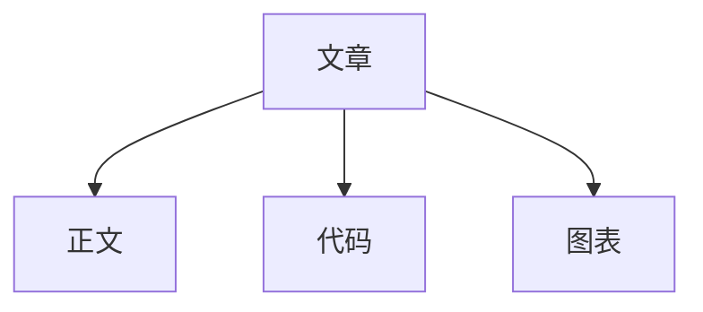

这是一篇可以直接阅读、对照和检查的渲染展示文章。往下滚动，看看同一套排版如何处理中文正文、各级标题、代码、公式和图表；也可以通过右侧目录跳到相应章节。

## 一、标题层级

下面连续展示正文中的六级标题。文章顶部的文章标题独立于这六个示例；正文中的二至六级标题会进入阅读目录，并按层级缩进。

# 一级标题 · 大章节

一级标题下的正文，用来观察标题与段落之间的留白。

## 二级标题 · 主要章节

二级标题组织文章的主要内容，也是阅读目录的一级条目。

### 三级标题 · 章节中的小节

三级标题进一步划分内容，在目录中归属相应二级标题。

#### 四级标题 · 更具体的说明

四级标题适合较短的说明段落。

##### 五级标题 · 细节补充

五级标题可以承载更细的内容层次。

###### 六级标题 · 最小层级

六级标题之后，正文恢复日常阅读的字号和行距。

## 二、正文与行内样式

这是一个普通中文段落。标点、英文 Jianxi、数字 2026 和技术词 Markdown 会在同一行中出现。一个舒适的阅读页面，需要让长句顺着行距自然展开，也需要让短句保留呼吸的空间。

第二个段落与前一个段落之间由空行分隔。**这段文字加粗**，*这段文字强调*，***这段文字同时加粗和强调***，~~这段文字使用删除线~~。行内代码像这样：`const title = "间隙"`，适合展示变量、路径和命令。

这里展示显式换行：这一句结束后换到下一行。  
这一句仍然属于同一个段落。

需要显示语法本身时，可以使用转义：\*星号\*、\[方括号\]、\#井号，以及字面美元符号 \$20。代码里的 `$E=mc^2$` 保持原样。

### 关键词描述

点击带虚线下划线的术语，可以在当前阅读位置查看解释。例如，一个接口需要保证 [[幂等性|无论执行一次还是多次，产生的效果都相同。例如，多次点击提交按钮，只创建一笔订单。]]；一组数据库操作可以通过 [[事务|把多步操作作为一个整体处理：要么全部成功，要么全部失败，避免留下只完成一半的数据。]] 保持一致。

这篇文章在发布前经过 [[静态编译|将 Markdown、代码、公式和图表预先转换成 HTML 与静态资源。读者访问时直接读取这些结果。]]。多人修改同一篇文章时，还可以使用 **[[乐观锁|提交时检查读取版本与当前版本是否一致。如果别人已经修改了内容，本次提交会提示冲突，避免覆盖别人的工作。]]**。

| 场景 | 可以点击的术语 |
| --- | --- |
| 多次请求仍只生效一次 | [[幂等性\|相同操作重复执行，结果保持一致。表格内的关键词也可以弹出说明。]] |
| 两步数据库操作一起完成 | [[事务\|所有操作作为一个整体提交，任意一步失败时撤销整组操作。]] |

浮窗支持关闭按钮、Esc 和点击空白处关闭，长说明可以在浮窗内滚动。

### 链接与自动链接

这是一个[站内链接：关于我](/about/)，以及一个[站内链接：文章时间线](/timeline/)。下面的 HTTPS 地址展示自动链接样式：

https://example.com

### 脚注

段落可以引用脚注，用来补充说明而不打断正文。[^rendering] 同一篇文章也可以有第二条脚注。[^static]

## 三、引用与分隔线

> 给想法，留一点间隙。
>
> 引用可以包含多个段落，也可以包含 **加粗**、*强调* 和 `行内代码`。
>
> > 这是嵌套引用，用来观察第二层引用的缩进和边线。

下面是一条分隔线。

---

分隔线之后继续正文，观察上下留白。

## 四、列表与任务清单

### 无序列表

- 中文段落与行内样式
- 代码、公式和图表
  - 代码块可以标注语言
  - 公式可以放在行内或单独成块
    - 嵌套列表展示第三层缩进
- 图片与链接

### 有序列表

1. 先准备文章正文。
2. 再查看渲染后的页面。
   1. 检查标题层级。
   2. 检查代码和表格的横向滚动。
3. 最后检查手机阅读效果。

### 宽松列表

- 第一项有一段主要说明。

  这一段仍属于第一项，用来展示列表内的段落间距。

- 第二项也有独立内容。

  **列表中同样支持行内强调。**

### 任务列表

- [x] 展示六级标题
- [x] 展示代码高亮和复制按钮
- [x] 展示公式与图表
- [ ] 留一个未完成项目，观察复选框的两种状态

## 五、表格

表格支持表头和列对齐，单元格中也可以使用行内样式。

| 渲染元素（左对齐） | 示例（居中） | 数量（右对齐） |
| :--- | :---: | ---: |
| 标题 | `H1` 至 `H6` | 6 |
| **强调** | *普通强调* | 2 |
| 代码语言 | `go`、`javascript`、`python` | 3 |
| 列表 | ~~过时条目~~ | 4 |

下面是一张较宽的表格，方便观察手机上的横向滚动。

| 内容类型 | 写作方式 | 页面结果 | 主要观察点 | 示例用途 |
| --- | --- | --- | --- | --- |
| 普通正文 | Markdown 段落 | 连续的阅读内容 | 中文行距与段落留白 | 日常记录与长文 |
| 代码块 | 带语言的围栏 | 高亮代码与复制按钮 | 长行与特殊字符 | 技术说明与命令示例 |
| 数学公式 | LaTeX 表达式 | 排版后的公式 | 分式、矩阵与符号 | 数学推导与算法解释 |
| 图表 | Mermaid 围栏 | 静态图与可展开源码 | 中文标签与图形边界 | 流程、关系与时间安排 |

## 六、代码块

### Go

```go
package main

import "fmt"

func main() {
    title := "给想法，留一点间隙。"
    for i := 1; i <= 3; i++ {
        fmt.Printf("%d. %s\n", i, title)
    }
}
```

### JavaScript

```javascript
// 中文注释、字符串、布尔值和模板字符串
const article = { title: "渲染展示", published: true };

function describe({ title, published }) {
  return `${title} · ${published ? "已发布" : "草稿"}`;
}

console.log(describe(article));
```

### Python

```python
def reading_minutes(characters: int, speed: int = 400) -> int:
    """按照每分钟阅读字数估算时长。"""
    return max(1, (characters + speed - 1) // speed)

print(reading_minutes(2400))
```

### JSON

```json
{
  "title": "间隙 · 文章渲染展示",
  "slug": "rendering-showcase",
  "tags": ["个人博客", "渲染"],
  "published": true,
  "readingMinutes": 8
}
```

### 命令行

```bash
npm ci
npm run assets
go run ./cmd/jianxi serve --data data/dev
```

### HTML 源码展示

HTML 放在代码块中会显示为源码。

```html
<article class="example">
  <h2>这里是 HTML 代码示例</h2>
  <button onclick="alert('示例')">按钮源码</button>
  <p>特殊字符：&lt;、&gt;、&amp;</p>
</article>
```

### 无语言代码块与长行

```
这是一段没有指定语言的代码，适合日志或纯文本。
status=ok | title=渲染展示 | message=这是一行很长的日志，用来检查代码区域能否独立横向滚动，同时保持文章正文、目录和整个页面的宽度稳定。0123456789abcdefghijklmnopqrstuvwxyzABCDEFGHIJKLMNOPQRSTUVWXYZ
```

## 七、数学公式

### 行内公式

质能关系 $E=mc^2$ 可以嵌在句子中；二次函数 $f(x)=ax^2+bx+c$ 和求和 $\sum_{i=1}^{n}i=\frac{n(n+1)}{2}$ 也可以与正文并排阅读。

### 独立公式

$$
\int_0^1 x^2\,\mathrm{d}x = \frac{1}{3}
$$

$$
x = \frac{-b \pm \sqrt{b^2-4ac}}{2a}
$$

### math 围栏：矩阵与多行推导

```math
\begin{pmatrix}
1 & 2 \\
3 & 4
\end{pmatrix}
\begin{pmatrix}
x \\
y
\end{pmatrix}
=
\begin{pmatrix}
x+2y \\
3x+4y
\end{pmatrix}
```

```math
\begin{aligned}
(a+b)^2 &= (a+b)(a+b) \\
        &= a^2 + 2ab + b^2
\end{aligned}
```

## 八、Mermaid 图表

以下展示当前支持的九类图表。每张图下面都可以展开源码，对照图形与写法。

### 流程图


### 时序图



### 类图



### 状态图



### 实体关系图



### 甘特图



### 饼图



### 时间线图



### graph 写法



## 九、图片与媒体

### 本站图片

下面使用博客桌面页面的截图，观察图片宽度、圆角和与正文之间的间距。


图片支持替代文本。当前可以上传 PNG、JPEG、WebP、AVIF 和 GIF，正文也可以引用 HTTPS 外链图片。

### 视频链接

文章的视频区域支持标准哔哩哔哩 BV 链接，公开页面会显示播放器，默认不自动播放；其他平台显示跳转链接。本文不指定演示视频。

## 十、重复标题与阅读目录

下面两个三级标题使用相同文字，方便检查目录能否分别跳转。

### 同名小节

这是第一个同名小节，内容标记为 A。

### 同名小节

这是第二个同名小节，内容标记为 B。

## 十一、组合排版

> 一段引用里，可以同时放入 **重点文字**、`inline code` 和公式 $a^2+b^2=c^2$。

1. 先读一段普通正文，再查看下面的代码。

   ```go
   fmt.Println("列表中的代码块")
   ```

2. 再看一张放在列表里的小表格。

   | 项目 | 状态 |
   | --- | --- |
   | 标题 | 已展示 |
   | 正文 | 已展示 |

3. 最后回到普通段落，检查各种元素之间的节奏。

这篇文章可以作为今后调整字体、间距、代码配色和移动端排版时的对照样本。

[^rendering]: 脚注正文同样支持 **加粗** 和 `行内代码`，并提供返回引用位置的链接。
[^static]: 正文、公式和图表在发布前生成；阅读时，代码复制和目录定位等交互由页面提供。
