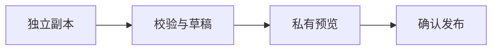

## 把内容交给静态页面

这是富内容验收样例。普通正文、公式、代码和图表都在发布前编译。

正文中的 [[静态编译|在发布前生成页面内容，读者访问时直接读取生成结果。]] 可以点击查看说明。

重复提交需要保证 [[幂等性|相同操作重复执行，产生的效果保持一致。]]；多步数据库更新可以使用 [[事务|把多步操作作为整体提交，全部成功或全部撤销。]]，提交版本校验则依靠 [[乐观锁|只有当前版本与读取时一致才允许提交，避免覆盖其他人的修改。]]。

行内公式：$E=mc^2$。字面美元符号：\$20。

$$
\int_0^1 x^2\,dx = \frac{1}{3}
$$

## 一段 Go 代码

```go
package main

import "fmt"

func main() {
    fmt.Println("给想法，留一点间隙。")
}
```

HTML 教学示例只展示源码，不会执行。

```html
<button onclick="alert('示例')">这是一段代码</button>
```

## 从源文到页面



## 列表与表格

- [x] 正文静态可读
- [x] 中文目录锚点
- [x] 代码转义与高亮

| 格式 | 发布结果 |
| --- | --- |
| Markdown | 静态 HTML |
| LaTeX | HTML 与 MathML |
| Mermaid | 静态 SVG |

> 简单，是有意识地保留重要的部分。
